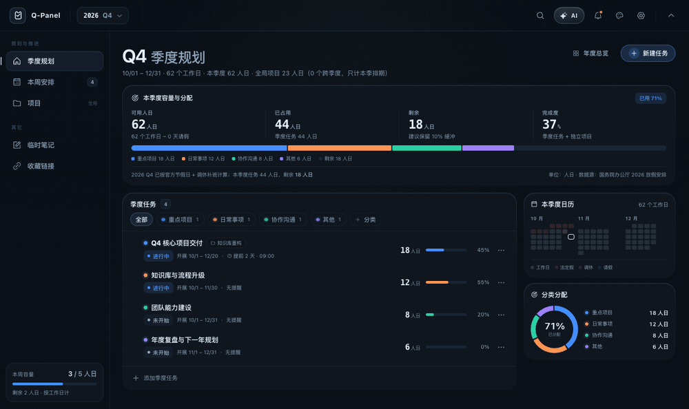
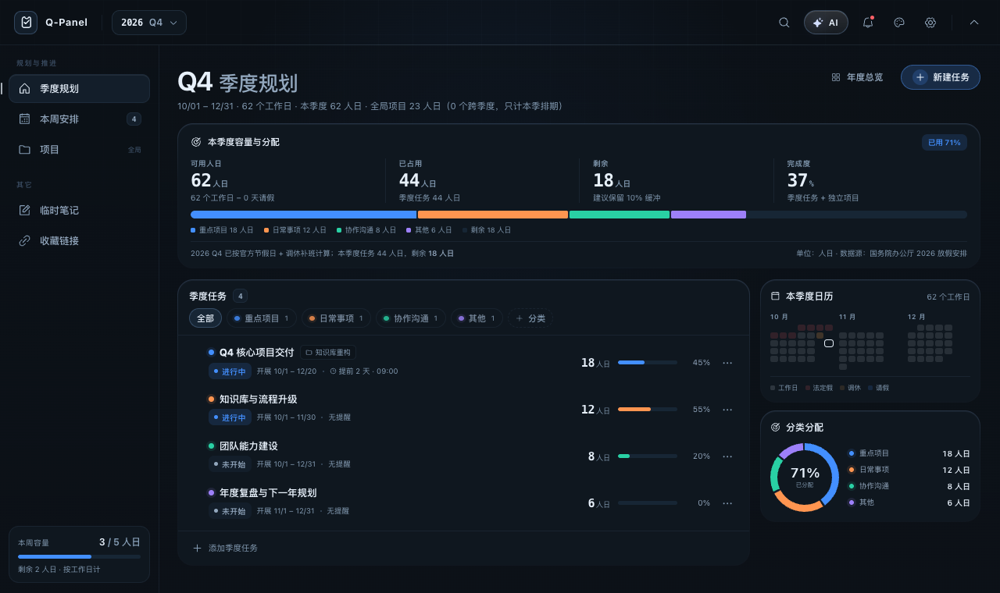
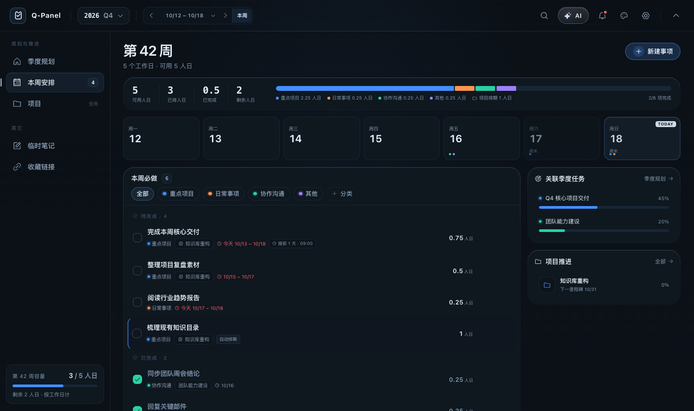
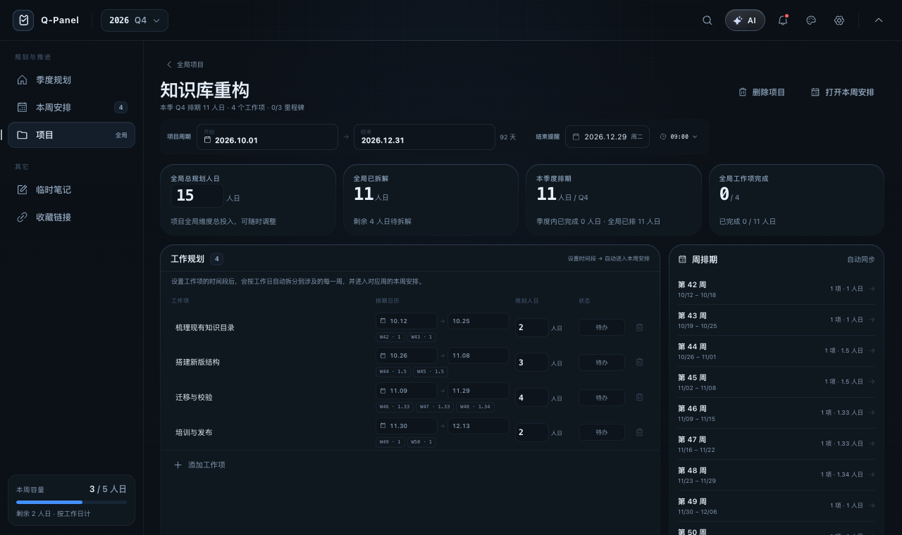

# Q-Panel

[简体中文](README.md) · **English**

> **A local-first personal workbench for quarterly goals, weekly must-dos and long-running projects.**
>
> Break yearly goals into weeks, and turn every week into work that actually gets done.

[](https://github.com/linfeng7z/Q-Panel/actions/workflows/build.yml)
[](LICENSE)


[](https://github.com/linfeng7z)

**Crafted by [linfeng7z](https://github.com/linfeng7z)** · v1.3.0 · macOS first, Windows/Linux experimental

[Preview](#preview) · [Features](#features) · [Download](#download) · [Build from source](#build-from-source) · [GitHub Actions](#github-actions) · [Disclaimer](#disclaimer)

---

## Preview



| Quarterly planning | Weekly must-dos | Project detail |
| --- | --- | --- |
|  |  |  |

---

## Features

### Quarterly planning with real capacity

- Plan in **person-days**, not vague hours: `0.25 / 0.5 / 1 / 1.5` days are all valid.
- Workdays are calculated from weekends, Chinese public holidays and make-up workdays.
- Add leave, training or other unavailable days and see the capacity update immediately.
- Track available, committed, remaining and completion figures for each quarter.
- See over-allocation early instead of discovering it at the end of the quarter.
- Objectives support planned days, start/end dates, due date, reminder, progress and status.
- Objective and project links share one capacity calculation, avoiding double counting.

### Weekly must-do list

- Every item in a week is a must-do: manually created tasks and project-scheduled items use the same list.
- Check items off, filter by category or by day, and see the week's planned person-days.
- Items left unchecked in the previous week appear in a backlog.
- Move the backlog into the current week with one action; completed previous items never reappear.
- Project-scheduled items participate in the same checklist, capacity and completion figures.

### Projects and automatic scheduling

- Create long-running projects with total planned days, dates, status, category and description.
- Plan work items with a date range and planned days.
- A work item is automatically split across **every overlapping week**, weighted by workdays:
  - A `10.12 – 10.31` item with 10 planned days becomes W42 + W43 + W44 slices;
  - Weekly slices sum back to 10;
  - Each overlapping week gets its own scheduled record.
- Manual removal from one week is remembered and does not affect other weeks.
- Milestones, project progress, current-quarter load and remaining unplanned days stay in sync.
- Link a project to a quarterly objective without counting its execution twice.
- Hover a weekly item to highlight its objective/project and draw the relationship animation.

### Reminders, notes and links

- Absolute date + 24-hour time reminders for objectives, weekly items and projects.
- macOS notifications, in-app reminder cards, snooze, missed reminder recovery and DND hours.
- Quick notes with title/heading sync, pinning and deletion.
- Link collections with search, editing, custom categories and automatic title/description metadata.
- Link fetching runs in the main process and blocks private networks, credentials in URLs and unsafe redirects.

### Optional AI assistant

- Connect any OpenAI-compatible endpoint; no model is bundled.
- AI proposals are previewed before anything is written.
- Choose how much workspace context to send: minimal, summary or full.
- API keys are stored with Electron `safeStorage`; the renderer never sees the plaintext key.
- Without a configured key, Q-Panel shows setup guidance instead of fake generated data.

### Local-first details

- Atomic local workspace writes.
- Daily backups, retained for 14 days by default.
- Full JSON import/export and automatic schema migration.
- Four themes (Noir / Ops / Aurora / Ember).
- Adjustable background material, with a readable solid fallback when screen capture permission is unavailable.
- ⌘K command palette, customizable global shortcut and menu-bar/tray access.
- All motion respects `prefers-reduced-motion`.
- Interface language: **Simplified Chinese / English (Beta, core UI)**.

---

## Platform support

| Platform | Status | Notes |
| --- | --- | --- |
| macOS (Apple Silicon) | ✅ Stable | Primary target; notch panel, menu bar, notifications and background material |
| macOS (Intel) | ✅ Build available | Built by GitHub Actions as x64 DMG |
| Windows x64 | ⚠️ Experimental | Built by CI; no notch/menu-bar-first experience; not runtime-tested by the maintainer |
| Linux x64 | ⚠️ Experimental | AppImage built by CI; desktop tray/notification behavior varies by distribution |

The macOS app is the only officially supported target. Windows and Linux artifacts are provided for evaluation and feedback, not as a promise of parity.

---

## Download

Download the latest installer from [GitHub Releases](https://github.com/linfeng7z/Q-Panel/releases/latest):

- macOS Apple Silicon: `Q-Panel-1.3.0-mac-arm64.dmg`
- macOS Intel: `Q-Panel-1.3.0-mac-x64.dmg`
- Windows x64 (experimental): `Q-Panel-1.3.0-win-x64-setup.exe`
- Linux x64 (experimental): `Q-Panel-1.3.0-linux-x64.AppImage`

### macOS first launch

Q-Panel is currently **ad-hoc signed and not notarized**. macOS may block the first launch. Right-click the app → **Open** → confirm to open it. This is a known limitation of the current release; Apple Developer ID signing and notarization can be added later.

Only download builds from this repository's Releases page. Do not run installers from unknown sources.

---

## Build from source

Requirements:

- Node.js `>= 22.12`
- npm
- macOS for the primary desktop experience; Windows/Linux builds are experimental

```bash
git clone https://github.com/linfeng7z/Q-Panel.git
cd Q-Panel

cd prototype
npm install
npm run build

cd ../electron
npm install
npm run pack
```

Local output:

```text
electron/release/Q-Panel-1.3.0-mac-arm64.dmg
electron/release/mac-arm64/Q-Panel.app
```

Development:

```bash
# terminal 1
cd prototype
npm install
npm run dev

# terminal 2
cd electron
npm install
npm run dev
```

Useful `electron` scripts:

```text
npm run pack        macOS arm64 (local quick build)
npm run pack:mac    macOS arm64 + x64
npm run pack:win    Windows x64 (experimental)
npm run pack:linux  Linux x64 AppImage (experimental)
```

---

## GitHub Actions

`.github/workflows/build.yml` builds on GitHub-hosted runners:

- **Push a tag** like `v1.3.0` → build macOS, Windows and Linux artifacts, then create a GitHub Release with the installers.
- **Pull request / main push** → run the same build checks without publishing a release.
- **Manual run** → trigger the workflow from the Actions tab.

The macOS and experimental jobs are separate. A failed Windows/Linux build does not prevent the macOS release from being published; the release job uploads the artifacts that succeeded.

---

## Data and privacy

- No account and no telemetry.
- Task, project, note and link data is stored locally at `~/Library/Application Support/Q-Panel/` on macOS.
- Network requests only occur when you explicitly use AI, fetch link metadata, or check holiday data.
- Screen capture, when enabled, is used only for local background ambience; it is not stored or uploaded.
- AI API keys are encrypted via the operating system's secure storage.
- You can export, back up or delete the workspace at any time.

See [SECURITY.md](SECURITY.md) for vulnerability reporting.

---

## Known limitations

- Primary support is macOS; Windows/Linux artifacts are experimental.
- macOS release is ad-hoc signed, not notarized; Gatekeeper may block first launch.
- English UI is a beta covering the core navigation, planning, weekly plan and project screens; some advanced settings and edge-state copy may still be Chinese.
- No cloud sync, real-time collaboration or multi-user workspace.
- No mobile client.
- AI requires your own OpenAI-compatible service.
- Reminders depend on OS notification permissions and the app running; do not use Q-Panel as the only alert channel for critical work.
- Person-day estimates are planning estimates, not productivity guarantees.

---

## Reference project

Q-Panel's product direction and some interaction ideas are inspired by [xiaopu-ai/TO-DO-Panel](https://github.com/xiaopu-ai/TO-DO-Panel), an MIT-licensed project.

The reference project's copyright and MIT notice are retained in [THIRD_PARTY_NOTICES.md](THIRD_PARTY_NOTICES.md). Q-Panel uses its own product name, UI, code and demo assets. If future changes directly reuse reference code or assets, the original MIT notice will continue to apply to those portions.

---

## Disclaimer

1. **Data loss**: Q-Panel is local-first and has no cloud backup. Deleting the workspace, backups, app data or the machine's disk can cause permanent data loss. Keep your own backups.
2. **Reminders**: Notifications depend on OS permissions, app state and scheduling. Do not rely on Q-Panel as the sole reminder for medical, financial, production or other high-risk events.
3. **AI output**: AI-generated plans and suggestions may be inaccurate or inappropriate. Review before using; you are responsible for decisions.
4. **Estimates**: Person-day capacity, progress and completion are estimates, not commitments.
5. **No professional advice**: Q-Panel does not provide legal, tax, financial, medical, security-compliance or HR advice.
6. **Third-party services**: AI providers and link metadata services are governed by their own terms and privacy policies.
7. **No warranty**: The software is provided **“AS IS”**, without warranties of any kind, express or implied.
8. **Limitation of liability**: To the maximum extent permitted by law, the author and contributors are not liable for any direct, indirect, incidental or consequential damages from using or being unable to use Q-Panel.
9. **Unsigned builds**: macOS builds are ad-hoc signed and not notarized. Only use official Releases or build from source.

---

## Contributing

Issues, design feedback, documentation fixes and code contributions are welcome.

- Read [CONTRIBUTING.md](CONTRIBUTING.md) before opening a PR.
- Report security issues privately via [SECURITY.md](SECURITY.md).
- Never include API keys, personal tasks, logs or private screenshots in an issue.
- For capacity, week-scheduling or project-sync changes, describe the semantic change and migration impact in the PR.

If Q-Panel helps your work, a Star ⭐ helps more people find it.

---

## License

[MIT](LICENSE) © 2026 **linfeng7z**

Q-Panel · v1.3.0 · [GitHub](https://github.com/linfeng7z/Q-Panel)
