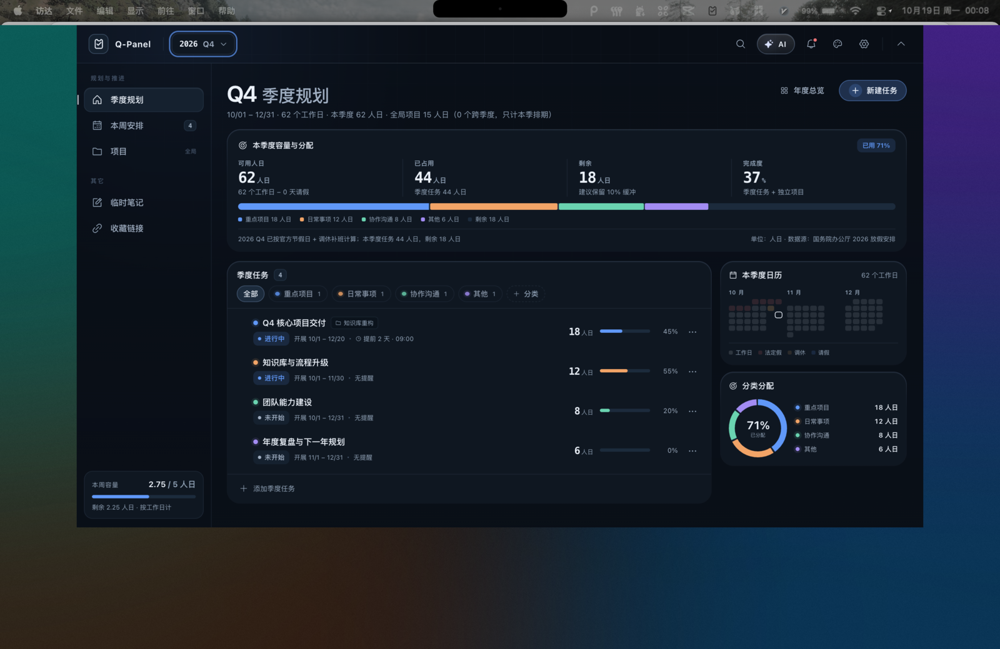
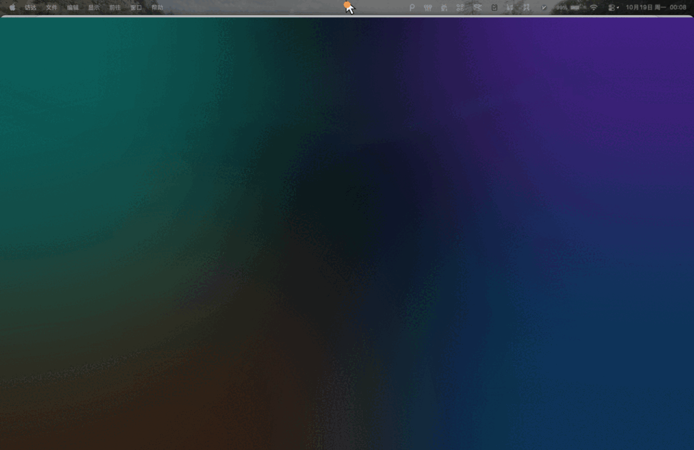

# Q-Panel

**简体中文** · [English](README.en.md)

> **面向个人的本地优先工作台：季度目标、每周必做、长期项目。**
>
> 把年度目标拆到每一周，把每一周变成能完成的事。

[](https://github.com/linfeng7z/Q-Panel/actions/workflows/build.yml)
[](LICENSE)


[](https://github.com/linfeng7z)

**Crafted by [linfeng7z](https://github.com/linfeng7z)** · v1.3.0 · macOS 优先，Windows/Linux 实验性

[桌面体验](#桌面体验) · [功能](#功能) · [下载](#下载) · [源码构建](#源码构建) · [GitHub Actions](#github-actions) · [免责声明](#免责声明)

---

## 桌面体验



**点击 Mac 屏幕顶部中央的刘海，Q-Panel 会贴着屏幕顶部展开。**

它不是普通窗口：平时收在菜单栏/刘海区域，不占 Dock、不进入程序坞；点击刘海热区后，面板贴着屏幕顶部与刘海下缘展开，只占屏幕顶部，始终浮在当前桌面之上。再点一次刘海、按 `Esc` 或点击面板外部即可收起。



> 桌面效果示意图：系统壁纸 + Q-Panel 真实运行界面；任务内容为演示数据。
> [观看 MP4 演示](docs/desktop-demo.mp4)

## 界面细节


| 季度规划 | 本周必做 | 项目详情 |
| --- | --- | --- |
|  |  |  |

---

## 功能

### 基于真实容量的季度规划

- 使用 **人日** 规划，而不是模糊的小时数：`0.25 / 0.5 / 1 / 1.5` 人日都可以。
- 按周末、中国法定节假日和调休补班日自动计算工作日。
- 添加请假、培训或其他不可用日期后，容量立即更新。
- 查看每个季度的可用、已占用、剩余和完成度。
- 提前发现超载，而不是在季度末才发现做不完。
- 季度任务支持计划人日、起止日期、截止日、提醒、进度和状态。
- 季度任务和项目关联后共用一套容量口径，不重复计算。

### 本周必做

- 本周的所有事项都是必做：手动创建的事项和项目自动排期进入同一份清单。
- 勾选完成、按分类或日期筛选，并查看本周已排人日。
- 上周未勾选的事项会进入 **上期未完成**。
- 一键把上期未完成移入本周；已完成的旧事项不会重复出现。
- 项目自动排期同样参与本周清单、容量和完成度统计。

### 项目与自动排期

- 创建长期项目，填写总规划人日、起止日期、状态、分类和说明。
- 工作项可以设置日期范围和规划人日。
- 工作项会自动拆分到 **所有重叠的周**，并按工作日加权：
  - 例如 `10.12 – 10.31`、总规划 10 人日，会拆成 W42 + W43 + W44；
  - 三周分摊合计仍然等于 10；
  - 每个重叠周都会生成一条排期记录。
- 从某一周手动移除后，该周不再自动同步，其他周不受影响。
- 里程碑、项目进度、本季度投入和剩余待拆解人日实时同步。
- 项目可以关联季度任务，执行明细归入任务拆解，不再重复占用容量。
- 悬停本周事项时，关联季度任务/项目自动高亮，并绘制关系动画。

### 提醒、笔记与链接

- 季度任务、本周事项和项目都支持绝对日期 + 24 小时制提醒。
- macOS 系统通知、应用内提醒、稍后提醒、错过提醒补发和免打扰时段。
- 临时笔记支持标题/一级标题同步、置顶和删除。
- 收藏链接支持集合、搜索、编辑、自定义分类和标题/描述元数据自动抓取。
- 链接抓取在主进程完成，并阻断私网、URL 凭据和不安全重定向。

### 可选 AI 助手

- 支持任意 OpenAI 兼容接口，不内置模型。
- AI 生成的事项先预览，确认后才写入。
- 可以控制发送给 AI 的上下文：最小、摘要或全部。
- API Key 使用 Electron `safeStorage` 保存，渲染层拿不到明文。
- 没有配置 Key 时显示配置引导，不生成假数据。

### macOS 刘海交互

- 平时收在菜单栏/刘海热区，不占 Dock、不进入程序坞。
- 点击屏幕顶部中央的刘海展开；面板贴着屏幕顶部与刘海下缘展开，只占屏幕顶部，不铺满整块桌面。
- 再点刘海、按 `Esc` 或点击面板外部收起；支持 ⌘⇧Space 全局快捷键。
- 窗口始终浮动在当前桌面之上，支持全屏空间和多个桌面。

### 本地优先细节

- 本地工作区原子写入。
- 默认每日备份，保留最近 14 天。
- 完整 JSON 导入/导出和旧版 schema 自动迁移。
- 四套主题：Noir / Ops / Aurora / Ember。
- 可调背景材质；没有屏幕录制权限时回退为可读的纯色背景。
- ⌘K 命令面板、自定义全局快捷键、菜单栏/托盘入口。
- 所有动效尊重 `prefers-reduced-motion`。
- 界面语言：**简体中文 / English（Beta，核心界面）**。

---

## 平台支持

| 平台 | 状态 | 说明 |
| --- | --- | --- |
| macOS（Apple Silicon） | ✅ 稳定 | 主要目标；点击刘海展开、贴顶面板、菜单栏、通知和背景材质 |
| macOS（Intel） | ✅ 可构建 | GitHub Actions 生成 x64 DMG |
| Windows x64 | ⚠️ 实验性 | CI 构建；没有刘海/菜单栏优先体验，维护者未做运行验证 |
| Linux x64 | ⚠️ 实验性 | CI 生成 AppImage；托盘/通知行为依赖发行版 |

macOS 是唯一正式支持的目标。Windows/Linux 产物用于评估和反馈，不代表与 macOS 完全一致。

---

## 下载

从 [GitHub Releases](https://github.com/linfeng7z/Q-Panel/releases/latest) 下载最新版本：

- macOS Apple Silicon：`Q-Panel-1.3.0-mac-arm64.dmg`
- macOS Intel：`Q-Panel-1.3.0-mac-x64.dmg`
- Windows x64（实验性）：`Q-Panel-1.3.0-win-x64-setup.exe`
- Linux x64（实验性）：`Q-Panel-1.3.0-linux-x86_64.AppImage`

### macOS 首次打开

Q-Panel 当前为 **ad-hoc 签名，未公证**。macOS 可能拦截首次启动：

1. 右键 App → **打开**；
2. 在提示框中再次确认打开。

这是当前版本的已知限制，后续可以升级为 Apple Developer ID 签名和 notarization。请只从本仓库的 Releases 页面下载，不要运行来源不明的安装包。

---

## 源码构建

环境要求：

- Node.js `>= 22.12`
- npm
- macOS（主要桌面体验）；Windows/Linux 构建为实验性

```bash
git clone https://github.com/linfeng7z/Q-Panel.git
cd Q-Panel

cd prototype
npm install
npm run build

cd ../electron
npm install
npm run pack
```

本地产物：

```text
electron/release/Q-Panel-1.3.0-mac-arm64.dmg
electron/release/mac-arm64/Q-Panel.app
```

开发模式：

```bash
# 终端 1
cd prototype
npm install
npm run dev

# 终端 2
cd electron
npm install
npm run dev
```

`electron` 构建脚本：

```text
npm run pack        macOS arm64（本地快速构建）
npm run pack:mac    macOS arm64 + x64
npm run pack:win    Windows x64（实验性）
npm run pack:linux  Linux x64 AppImage（实验性）
```

---

## GitHub Actions

`.github/workflows/build.yml` 在 GitHub 托管 runner 上执行：

- **推送 `v*` tag**：构建 macOS、Windows、Linux 产物，并创建 GitHub Release。
- **Pull Request / main push**：执行构建检查，不发布 Release。
- **手动触发**：在 Actions 页面运行。

macOS 与实验性平台分开构建；Windows/Linux 构建失败不会阻止 macOS Release，Release 会附带成功生成的产物。

---

## 数据与隐私

- 无账号、无遥测。
- 任务、项目、笔记和链接默认保存在本机；macOS 路径为 `~/Library/Application Support/Q-Panel/`。
- 只有在你主动使用 AI、抓取链接元数据或检查节假日数据时才会联网。
- 屏幕截图仅用于本地背景氛围，不存储、不上传。
- AI API Key 使用系统安全存储加密。
- 工作区可以随时导出、备份、导入或删除。

安全问题请阅读 [SECURITY.md](SECURITY.md) 并私密报告。

---

## 已知限制

- macOS 是主要支持平台；Windows/Linux 产物为实验性。
- macOS 版本为 ad-hoc 签名、未公证；Gatekeeper 可能拦截首次启动。
- 英文界面为 Beta，覆盖核心导航、季度规划、本周安排和项目页；部分高级设置与边缘提示仍为中文。
- 没有云同步、实时协作或多用户工作区。
- 没有移动端客户端。
- AI 需要你自己的 OpenAI 兼容服务。
- 提醒依赖系统通知权限和应用运行状态；不要把 Q-Panel 作为关键场景的唯一提醒渠道。
- 人日容量是规划估算，不是生产率承诺。

---

## 参考项目

Q-Panel 的产品方向和部分交互思路参考了 [xiaopu-ai/TO-DO-Panel](https://github.com/xiaopu-ai/TO-DO-Panel)，该项目以 MIT License 发布。

参考项目的版权和 MIT 声明保留在 [THIRD_PARTY_NOTICES.md](THIRD_PARTY_NOTICES.md)。Q-Panel 使用自己的产品名、UI、代码和演示素材；如果未来直接复用参考项目的代码或资产，原 MIT 声明会继续适用于对应部分。

---

## 免责声明

1. **数据安全**：Q-Panel 是本地工具，不提供云备份。删除工作区、备份、应用数据或磁盘损坏都可能造成永久数据丢失，请自行备份。
2. **提醒**：通知依赖系统权限、应用状态和调度。不要把 Q-Panel 作为医疗、财务、生产或其他高风险事件的唯一提醒方式。
3. **AI 输出**：AI 生成的计划和建议可能不准确或不适用，请在采用前自行判断，最终决策由你负责。
4. **估算**：人日容量、进度和完成度都是估算，不是承诺。
5. **不提供专业建议**：Q-Panel 不提供法律、税务、财务、医疗、安全合规或人力资源建议。
6. **第三方服务**：AI 服务商和链接元数据服务适用各自的服务条款与隐私政策。
7. **无担保**：软件按 **“AS IS”** 提供，不附带任何明示或暗示担保。
8. **责任限制**：在适用法律允许的最大范围内，作者和贡献者不对使用或无法使用本软件造成的任何直接、间接、附带或后果性损失承担责任。
9. **未签名构建**：macOS 构建为 ad-hoc 签名、未公证；请只使用官方 Releases 或自行从源码构建。

---

## 贡献

欢迎 issue、设计建议、文档修正和代码贡献。

- 提交 PR 前请阅读 [CONTRIBUTING.md](CONTRIBUTING.md)。
- 安全问题请通过 [SECURITY.md](SECURITY.md) 私密报告。
- 不要在 issue 中粘贴 API Key、私人任务、日志或含隐私的截图。
- 修改容量、周排期或项目同步逻辑时，请在 PR 中说明口径变化和迁移影响。

如果 Q-Panel 对你有帮助，欢迎点一个 Star ⭐。

---

## License

[MIT](LICENSE) © 2026 **linfeng7z**

Q-Panel · v1.3.0 · [GitHub](https://github.com/linfeng7z/Q-Panel)
