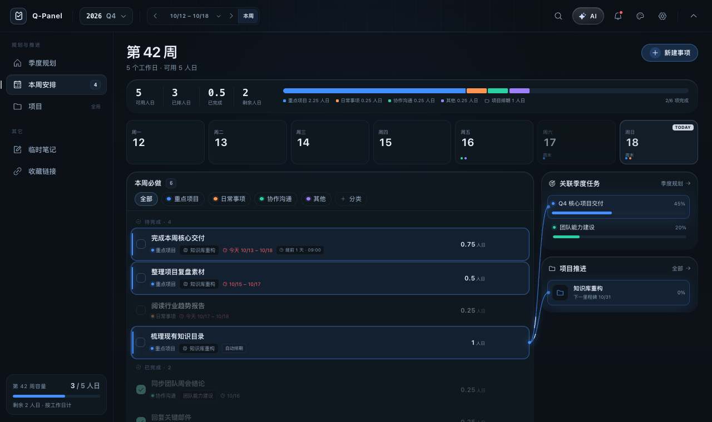

# Q-Panel · 打工人必备的本地优先工作台

> **把年度目标拆到每一周，把每一周变成能完成的事。**
>
> A local-first, open-source macOS workbench for quarterly goals, weekly must-dos and long-running projects — no account, no cloud, no telemetry.

[](LICENSE)


[](CONTRIBUTING.md)


**开发人员：linfeng7z** · 版本：1.2.0 · 平台：macOS（Apple Silicon）

[下载安装](#下载与安装) · [功能全景](#功能全景) · [开源条件分析](#开源条件分析) · [免责声明](#免责声明) · [参考项目](#参考项目与致谢)

<details>
<summary><strong>English overview</strong></summary>

**Q-Panel** is an open-source, local-first personal workbench for macOS. It connects quarterly goals, weekly must-dos, long-running projects, reminders, notes, links and optional AI assistance in one person-day-based system.

Highlights: quarterly capacity planning, automatic holiday calendar, weekly must-do list, multi-week project work-item scheduling, milestone tracking, project/quarter linking without double-counted capacity, backlog rollover, relationship highlighting, local JSON storage, daily backups, import/export, customizable global shortcut, command palette, four themes and an optional OpenAI-compatible AI assistant.

No account, no cloud sync and no telemetry by default. Built with Electron + React + TypeScript. MIT licensed. Keywords: personal productivity, weekly planner, quarterly planning, task management, project management, local-first, macOS, Electron, open source, to-do app, planner, OKR, time blocking, personal dashboard.

</details>

---

## 这是什么

Q-Panel 是一款面向 **macOS** 的个人工作台，把「季度目标 → 每周执行 → 长期项目 → 提醒/笔记/链接 → AI 辅助」串成一个闭环。

它不是又一个只会堆待办的清单，也不是需要团队一起上的重型项目管理软件。它解决的是一个很具体的问题：

> 年初定了目标，月底发现没动；  
> 项目一直在推进，但不知道本周到底该做什么；  
> 时间被会议、消息和临时事项切碎，真正重要的事没有落点。

Q-Panel 用 **人日（person-day）** 作为统一尺度：季度有多少可用人日、任务已经占用多少、项目拆出了多少、这一周还剩多少。所有计划都能落回到「今天要不要做、这周做不做得完」。

### 适合谁

- **打工人 / 上班族**：把 KPI、季度目标、项目和个人成长放进同一张工作台；
- **学生 / 研究生**：按学期或季度拆解论文、考试、课程和求职准备；
- **自由职业者 / 独立开发者**：同时管理多个客户、项目和交付节点；
- **项目负责人 / 小团队 Lead**：掌握项目全局投入、里程碑和本季度排期；
- **知识工作者**：把笔记、链接、提醒和行动项放在触手可及的地方；
- **任何不想把个人计划交给云端账号的人**。

---

## 演示


GIF 依次展示：季度容量与目标 → 本周必做与项目自动排期 → 关系高亮动效 → 项目列表 → 项目详情。

### 界面预览

| 季度规划：容量、目标和人日分配 | 本周安排：所有事项都是「本周必做」 |
| --- | --- |
|  |  |

| 项目与季度任务的关系动效 | 项目详情：工作项、周排期和里程碑 |
| --- | --- |
|  |  |

---

## 为什么是 Q-Panel

### 1. 以「人日」而不是「小时」做计划

很多工具要求你估算 45 分钟、2.5 小时，最后计划表变成一张没有意义的时间账本。Q-Panel 的统一单位是 **1 人日 = 1 个正常工作日**，支持 `0.25 / 0.5 / 1.5` 等人日粒度。

- 季度可用人日自动扣除周末、法定节假日和调休补班；
- 请假 / 不可用时间可以手动添加和删除；
- 已占用、剩余、完成度、超载一目了然；
- 数字可以为负数，提前暴露「本周根本做不完」。

### 2. 季度、周、项目三者不是三套系统

- **季度规划**回答「这个季度最重要的事是什么」；
- **本周安排**回答「这周具体做什么」；
- **项目**回答「这件跨周、跨月的事推进到哪了」。

同一个季度目标可以关联项目；项目工作项可以按起止日期自动拆分到多个周；周页里既有手写事项，也有从项目同步来的自动排期。它们共享同一套容量口径，不会各算各的。

### 3. 所有周事项都是「必做」

Q-Panel 不再区分「普通待办」和「项目事项」两套清单。项目自动排期和手动事项统一进入 **本周必做**：

- 统一勾选完成；
- 统一计入本周已排人日；
- 统一参与本周容量和完成度；
- 项目来源只作为一个小标签，不再让同步事项显得「低优先级」。

### 4. 本地优先，没有账号

Q-Panel 默认完全本地运行：

- 不需要注册账号；
- 不上传任务、项目、笔记和链接；
- 不包含遥测 / 埋点；
- 数据是一个可读的本地 JSON 工作区，随时可以备份、迁移、删除。

AI 是可选能力：你可以接自己的 OpenAI 兼容服务，也可以完全不配置。

---

## 功能全景

### 🗓️ 季度规划与容量

- 按自然季度展示目标、人日、进度和剩余容量；
- 基于中国官方节假日 + 调休补班日历计算工作日；
- 支持手动添加请假、培训、占用等不可用日期；
- 自动计算：可用人日、已占用、剩余、完成度、建议缓冲；
- 分类堆叠条和分类分配环图，快速看清楚时间花在哪里；
- 目标支持计划人日、起止日期、截止日、提醒、进度和状态；
- 年度总览展开 Q1–Q4，跨季度目标一眼可见；
- 季度任务与项目可双向关联，容量去重不重复计算；
- 超载会直接显示红色数字和提示，而不是等到周末才发现。

### ✅ 本周安排与 backlog

- 当前周、上一周、下一周和任意 ISO 周切换；
- 周容量 = 工作日 − 请假，实时计算本周是否超载；
- 所有事项统一为「本周必做」，支持分类筛选、按天筛选和完成勾选；
- 顶部展示可用 / 已排 / 已完成 / 剩余人日；
- 上周未勾选的事项自动进入 **上期未完成** backlog；
- 一键「移入本周」，移入后立即从 backlog 消失；
- 上期已勾选完成的事项不会重复出现；
- 项目自动排期也按同一逻辑参与本周必做和完成度；
- 支持在周内按分类筛选和按具体日期查看。

### 📁 项目与自动排期

- 项目是全局维度：总规划人日、起止日期、状态、分类、说明；
- 本季度排期独立计算，跨季度项目不会把全年投入压到一个季度；
- 工作项可以设置起止日期和规划人日；
- 工作项会根据日期范围自动拆分到 **所有重叠周**：
  - 例如 `10.12 – 10.31`、总规划 10 人日的任务，会拆成 W42 / W43 / W44 三周；
  - 每周只计本周分摊人日，三周合计仍然等于 10；
  - 项目详情的「周排期」会为涉及到的每一周生成一条周记录；
- 工作项完成状态与周页勾选同步；
- 从某一周手动删除自动排期后，该周不再自动同步，其他周和后续编辑继续同步；
- 项目里程碑支持新增、改名、改日期和删除；
- 项目进度、本季度投入、全局已拆解 / 剩余待拆解全部实时更新；
- 可关联季度任务，使项目执行明细成为该季度的拆解而不重复占用容量。

### 🎯 目标与项目的关系可视化

- 悬停周事项，侧边栏对应的季度任务和项目自动高亮；
- 绘制流光关系曲线，其他事项同步变暗；
- 反向悬停侧栏季度任务 / 项目卡片，也会定位到本周事项；
- 项目自动排期同样参与关系高亮；
- 所有动效支持 `prefers-reduced-motion`。

### 🔔 提醒与通知

- 季度任务、周事项、项目都支持提醒；
- 提醒使用绝对日期 + 24 小时制整点，精确到日；
- 支持「跟随全局」和「自定义」两种提醒方式；
- macOS 系统通知为默认通道，应用内提醒卡片兜底；
- 支持稍后提醒、错过提醒补发、免打扰时段；
- 设置里可以发送测试提醒，确认通知权限链路；
- 手机或其他设备上的提醒不包含在本版本范围内。

### 📝 临时笔记

- 左侧「临时笔记」快速记录想法、会议纪要、复盘模板；
- 支持多篇笔记、标题编辑、置顶、删除；
- 笔记标题和 Markdown 一级标题保持同步；
- 空标题显示占位符，不会自动改写内容；
- 卡片等高、内容区独立滚动，长文阅读不破坏布局。

### 🔗 收藏链接

- 按「集合 / 列表」管理常用链接；
- 支持新增、编辑、删除、自定义集合标签和搜索；
- 粘贴 URL 时自动抓取标题和描述；
- 自动识别域名、显示 favicon / 字母图标；
- 链接元数据抓取只走主进程，带 SSRF / 私网 / 凭据 URL 防护。

### 🤖 AI 助手（可选）

- 支持 OpenAI 兼容接口，可接 DeepSeek、火山方舟、Ollama 或自己的服务；
- AI 生成任务提案，先预览、再确认写入，不直接改数据；
- 可以基于当前季度、项目和本周事项生成拆解建议；
- 可控制发送给 AI 的上下文范围：最小 / 摘要 / 全部；
- API Key 使用 Electron `safeStorage` 加密保存，渲染层不接触明文；
- 不配置 AI 时显示配置引导，不生成假数据；
- AI 输出仅供参考，重要决策请自行判断。

### ⌨️ macOS 原生体验

- **刘海面板**：平时收在 Mac 刘海位置，点击展开工作台；
- **菜单栏常驻**：托盘图标显示 / 隐藏 / 退出；
- **全局快捷键**：默认 `⌘ ⇧ Space`，可在设置中录制自定义组合键；
- **⌘ K 命令面板**：搜索页面、季度、周次和项目并快速跳转；
- 四套主题：**Noir / Ops / Aurora / Ember**；
- 背景材质与模糊度可调，支持无屏幕录制权限的纯色安全回退；
- 所有下拉框都是自定义键盘可操作菜单，不是系统原生控件；
- 日期 / 日期范围使用应用内日历，避免浏览器原生日期输入的割裂体验；
- 支持 Escape 收起、失焦收起、点击外部关闭。

### 🔐 本地数据与备份

- 工作区默认保存在 `~/Library/Application Support/Q-Panel/`；
- 原子写入，避免写一半损坏；
- 每日自动备份，保留最近 14 天（可在设置中调整）；
- 支持完整导出 / 导入 JSON；
- 旧 schema 自动迁移；
- 数据完全属于你：可以直接复制、备份、删除工作区。

---

## 快速开始

### 下载与安装

1. 打开 [GitHub Releases](https://github.com/linfeng7z/Q-Panel/releases/latest)；
2. 下载 `Q-Panel-1.2.0-arm64.dmg`；
3. 双击打开，将 **Q-Panel** 拖入「应用程序」；
4. 首次打开如果被 Gatekeeper 拦截：右键 App →「打开」→ 确认打开。

> **签名说明**：当前发布物为 **ad-hoc 签名、未公证**。它适合个人使用和内部测试。正式面向公众分发时，建议使用 Apple Developer ID 签名并完成 notarization，以避免 Gatekeeper 警告和系统权限异常。
>
> 不要执行来源不明的 `xattr` 命令；只在你信任该构建时使用右键打开。

首次启动为**空白工作区**，不会内置任何示例任务、项目或个人数据。

### 从源码构建

环境要求：

- macOS（Apple Silicon）
- Node.js `>= 22.12`
- npm

```bash
git clone https://github.com/linfeng7z/Q-Panel.git
cd Q-Panel

# 构建渲染层
cd prototype
npm install
npm run build

# 构建桌面壳并打包
cd ../electron
npm install
npm run pack
```

产物：

```text
electron/release/Q-Panel-1.2.0-arm64.dmg
electron/release/mac-arm64/Q-Panel.app
```

### 开发模式

```bash
# terminal 1
cd prototype
npm install
npm run dev

# terminal 2
cd electron
npm install
npm run dev
```

Vite 默认运行在 `http://127.0.0.1:5178/`。调试时可以用 `?now=2026-10-18T09:00:00+08:00` 冻结时间，方便检查跨周/跨季度逻辑。

---

## 设计原则

### 本地优先（Local-first）

默认不依赖服务器、账号和网络。任务、项目、笔记、链接、偏好和工作区都在本机。

### 一个尺度（One unit）

所有计划以人日为尺度。容量、任务、项目、周排期都使用同一套数字，不做「小时换算」和「感觉估算」的混用。

### 先容量，再承诺（Capacity before commitment）

先看这周 / 这季度有多少真实可用人日，再决定接多少事。超载不是错误，而是需要提前看见的信号。

### 所有事项都是必做（Everything in the week is must-do）

手动事项和项目自动排期共享同一张「本周必做」清单，不制造隐形优先级。

### 动效服务于理解（Motion for comprehension）

关系线、高亮、变暗和过渡动画只用来表达数据结构，不为了炫技牺牲性能；全部尊重减少动效设置。

### 数据属于用户（Your data, your file）

没有锁定格式和云同步依赖。工作区是可读 JSON，随时可以导出、迁移或删除。

---

## 常见使用流程

### 场景 A：把一个季度目标拆到每周

1. 新建季度任务「完成新版知识库」，填写计划人日 20；
2. 新建项目「知识库重构」，总规划 30 人日，关联该季度任务；
3. 拆出工作项：「目录梳理」2 人日、「结构设计」4 人日、「内容迁移」8 人日；
4. 给每个工作项设置起止日期；
5. 打开「本周安排」，项目工作项会自动出现在所有重叠周；
6. 每周只做本周分摊到的事项，季度容量不会重复计算。

### 场景 B：处理上周没做完的 backlog

1. 打开「本周安排」；
2. 顶部出现「上期有 N 项未完成」；
3. 点击「移入本周」；
4. 这些事项的周次和截止时间自动改到本周；
5. 将不需要的事项取消或调整日期，清单保持干净。

### 场景 C：把想法变成行动

1. 在「临时笔记」快速记下会议结论；
2. 在「收藏链接」保存参考资料，自动抓取标题和域名；
3. 把笔记里的行动点变成季度任务或本周必做；
4. 设置提醒，让系统在正确的时间提醒你。

### 场景 D：用 AI 做一次拆解

1. 设置 → AI 助手，填写 OpenAI 兼容 Base URL、模型和 API Key；
2. 打开 AI 抽屉，描述「把这个季度目标拆成本周 3 件事」；
3. 预览 AI 生成的任务提案；
4. 确认后才会写入，不会静默修改工作区。

---

## 技术栈与架构

| 层 | 技术 |
| --- | --- |
| 桌面壳 | Electron 44 |
| UI | React 19 + TypeScript |
| 构建 | Vite 8 |
| 图标 | Phosphor Icons |
| 数据 | 本地 JSON 工作区 + 原子写入 |
| 通知 | macOS Notification Center |
| AI | OpenAI 兼容 HTTP API（可选） |

```text
Q-Panel/
├── electron/                 # 桌面壳、原生窗口、IPC、提醒、数据存储
│   ├── main.mjs
│   ├── preload.cjs
│   ├── lib/
│   └── assets/
├── prototype/                # React 渲染层
│   ├── src/
│   │   ├── components/
│   │   ├── views/
│   │   ├── data/
│   │   └── styles/
│   └── dist/                 # 构建产物
├── docs/
│   ├── demo.gif
│   ├── screenshots/
│   ├── PRODUCT-PLAN.md
│   └── SIGNING.md
├── LICENSE
├── SECURITY.md
├── CONTRIBUTING.md
└── THIRD_PARTY_NOTICES.md
```

安全边界：

- `contextIsolation: true`
- `sandbox: true`
- `nodeIntegration: false`
- preload 仅暴露白名单 API；
- 外部链接交给系统浏览器；
- 链接元数据抓取在主进程完成，并阻断私网 / 凭据 / 危险重定向。

---

## 隐私与安全

- **无账号、无遥测、无埋点**；
- 默认不发起网络请求；
- 只有以下明确动作会联网：
  - 你配置并主动使用 AI 时；
  - 你粘贴链接并要求自动获取元数据时；
  - 你手动检查节假日数据时（如启用）；
- 屏幕截图仅用于可选的背景氛围，在本机内存中处理，不存储、不上传；
- API Key 使用系统安全存储，不写入渲染层；
- 工作区文件保存在本机，可直接删除。

### 报告安全问题

请阅读 [SECURITY.md](SECURITY.md)，通过 GitHub 私密安全公告报告，不要在公开 issue 中粘贴密钥、私人任务或完整日志。

---

## 已知限制

- 当前仅提供 **macOS arm64** 构建，不支持 Windows / Linux / Intel Mac；
- 发布物为 **ad-hoc 签名、未公证**；
- 无云同步，多设备需要手动复制 / 导出工作区；
- 无多人协作、评论和实时同步；
- AI 需要你自己提供兼容的 API 服务，不内置模型；
- 提醒依赖系统通知和应用常驻，不能替代专业值班 / 告警系统；
- 不进行税务、法律、合规或医疗建议；
- 人日容量是对工作时间的估算，不构成生产率承诺。

---

## 开源条件分析

> 以下是工程视角的发布前检查，不构成法律意见。正式发布前请自行或请专业人士确认品牌、版权、第三方许可证和分发合规性。

### 结论

**从许可证、依赖和数据边界看，Q-Panel 具备开源发布的基础条件。**

- 本项目使用 **MIT License**；
- 参考项目 [xiaopu-ai/TO-DO-Panel](https://github.com/xiaopu-ai/TO-DO-Panel) 同样使用 MIT；
- 主要依赖 Electron、Chromium、React、Phosphor Icons 均为宽松开源许可证；
- 仓库未包含真实 API Key、个人任务或用户数据；
- 无遥测、无账号系统，隐私边界清晰。

### 检查清单

| 检查项 | 状态 | 说明 |
| --- | --- | --- |
| 自有代码许可证 | ✅ | `LICENSE` 为 MIT |
| 参考项目许可证 | ✅ | 参考项目为 MIT，已保留来源与版权说明 |
| 依赖许可证 | ✅ | 主要依赖为 MIT / BSD 系宽松许可证 |
| 敏感信息 | ✅ | 未提交 API Key、Token、个人工作区 |
| 测试 / 演示数据 | ✅ | 应用默认空工作区；GIF/截图为独立演示文件 |
| 隐私与遥测 | ✅ | 无账号、无遥测；AI 与链接抓取按需触发 |
| 第三方声明 | ✅ | [THIRD_PARTY_NOTICES.md](THIRD_PARTY_NOTICES.md) |
| 安全报告渠道 | ✅ | [SECURITY.md](SECURITY.md) |
| 贡献指南 | ✅ | [CONTRIBUTING.md](CONTRIBUTING.md) |
| 品牌与名称 | ⚠️ 发布前确认 | “Q-Panel” 为通用产品名，建议检查 GitHub 组织名、商标和域名冲突 |
| macOS 正式分发 | ⚠️ 建议补强 | 当前 ad-hoc 签名；公开发布建议 Developer ID + notarization |
| 持续集成 / 自动化 | ⚠️ 可选 | 当前仓库未内置 CI；建议补 GitHub Actions 构建检查 |
| 视觉资产授权 | ⚠️ 发布前确认 | 确认 App 图标、截图和 GIF 均为自有或已获授权素材 |

### 关于参考项目

Q-Panel 的产品方向和部分交互思路参考了 **[xiaopu-ai/TO-DO-Panel](https://github.com/xiaopu-ai/TO-DO-Panel)**。

该参考项目以 **MIT License** 发布，允许使用、修改和再分发，但需要保留其版权和许可声明。本项目：

- 使用自己的产品名、UI、代码和演示数据；
- 在 [THIRD_PARTY_NOTICES.md](THIRD_PARTY_NOTICES.md) 中保留参考项目链接与 MIT 归属；
- 如未来直接复用参考项目的代码或静态资产，会继续按 MIT 条款保留原作者版权声明。

### 发布前建议

如果计划正式在 GitHub 公开发布并接受贡献，建议再补：

1. GitHub Actions 的 build / lint 工作流；
2. 代码签名与 notarization 流程；
3. `CHANGELOG.md` 和版本发布说明；
4. Issue / PR 模板；
5. 一张更完整的英文 README 或英文摘要；
6. GitHub Topics：`productivity`, `task-management`, `weekly-planner`, `quarterly-planning`, `local-first`, `macos`, `electron`, `react`, `personal-dashboard`。

---

## 免责声明

**请在使用前阅读。**

1. **数据安全**：Q-Panel 是本地工具，不提供云同步。删除工作区、清理备份、磁盘故障或系统重装都可能导致数据丢失。请自行建立备份习惯。
2. **提醒可靠性**：提醒依赖 macOS 通知权限、应用运行状态和系统调度。不要把 Q-Panel 用作医疗、财务、生产告警或其他高风险场景的唯一提醒手段。
3. **AI 输出**：AI 生成的任务、拆解和建议可能不准确、不完整或不适用于你的实际情况。AI 输出仅供参考，最终决策由你负责。
4. **估算误差**：人日容量、项目进度、剩余时间都是估算，不是承诺。工作内容受会议、沟通、外部依赖和个体差异影响。
5. **合规责任**：Q-Panel 不提供法律、税务、财务、医疗、安全合规或劳动管理建议。将本工具用于任何受监管场景前，请咨询相应专业人士。
6. **第三方服务**：AI 服务、链接元数据抓取等由你选择或触发的第三方交互，适用相应服务提供商的条款与隐私政策。
7. **无担保**：软件按 **“AS IS”** 提供，不附带任何明示或暗示担保，包括但不限于适销性、特定用途适用性和不侵权担保。
8. **责任限制**：在适用法律允许的最大范围内，作者和贡献者不对因使用或无法使用本软件造成的任何直接、间接、附带或后果性损失承担责任。
9. **签名与分发**：当前构建为 ad-hoc 签名、未公证。请从官方 GitHub Releases 或自行从源码构建；不要运行来源不明的可执行文件。

---

## 参考项目与致谢

- [**xiaopu-ai/TO-DO-Panel**](https://github.com/xiaopu-ai/TO-DO-Panel) — 产品方向和交互灵感参考，MIT License；
- [Electron](https://www.electronjs.org/) — 跨平台桌面应用框架；
- [React](https://react.dev/) — UI 基础；
- [Phosphor Icons](https://phosphoricons.com/) — 图标；
- [Vite](https://vite.dev/) — 前端构建工具。

感谢所有开源项目和贡献者。具体归属与许可证见 [THIRD_PARTY_NOTICES.md](THIRD_PARTY_NOTICES.md)。

---

## 贡献

欢迎 issue、设计建议、文档修正和代码贡献。

- 提交前先阅读 [CONTRIBUTING.md](CONTRIBUTING.md)；
- 安全漏洞请走 [SECURITY.md](SECURITY.md)；
- 不提交真实个人数据、API Key、日志或含隐私的截图；
- 改动计划/容量/项目同步逻辑时，请在 PR 中写清楚口径变化和迁移影响。

如果 Q-Panel 对你的工作和生活有帮助，欢迎点一个 Star ⭐，让更多打工人找到它。

---

## License

[MIT](LICENSE) © 2026 **linfeng7z**

> 开发与维护：linfeng7z · Q-Panel 1.2.0 · macOS arm64
